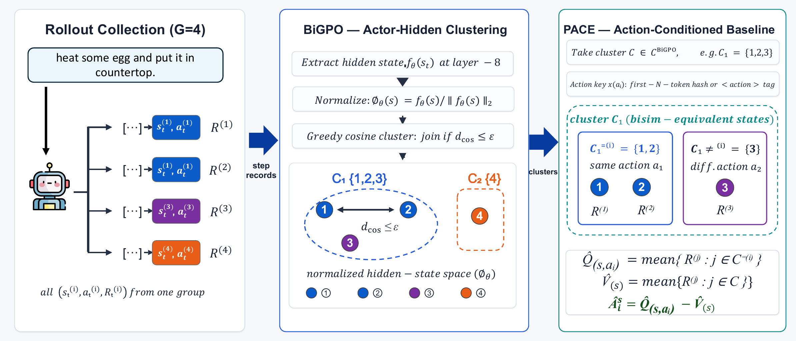

<h1 align="center">BiPACE</h1>

<h3 align="center">Bisimulation-Guided Policy Optimization with Action Counterfactual Estimation for LLM Agents</h3>

<p align="center"><strong>Behavioral state grouping. Action-conditioned credit. No critic.</strong></p>

<p align="center">
  <a href="https://github.com/TianxiangZhao/BiPACE"></a>
  <a href="./LICENSE"></a>
</p>

<p align="center">
  <a href="#why-bipace">Why BiPACE</a> ·
  <a href="#results">Results</a> ·
  <a href="#method">Method</a> ·
  <a href="#quick-start">Quick Start</a> ·
  <a href="#installation">Installation</a>
</p>

BiPACE is a drop-in advantage estimator for long-horizon LLM-agent reinforcement learning. It fixes a **state-action credit mismatch** in stepwise group-based RL: exact observation hashes split behaviorally reusable states into singleton groups, while a single group mean mixes state value with action-specific credit. BiPACE changes only the advantage estimator—no learned critic, auxiliary objective, reward model, or extra rollouts are required.

> BiPACE is developed on top of [verl-agent](https://github.com/langfengQ/verl-agent) and [veRL](https://github.com/volcengine/verl). The multi-turn rollout and environment interfaces remain compatible with the underlying training stack.

## Why BiPACE

Step-level policy optimization only works when the records being compared are meaningful peers. BiPACE addresses both sides of that comparison:

| | Existing step grouping | BiPACE |
| --- | --- | --- |
| **State side** | Exact observation identity creates singleton groups | **BiGPO** clusters the actor's normalized hidden states as a policy-induced bisimulation proxy |
| **Action side** | One within-group mean mixes different action outcomes | **PACE** estimates a local action-conditioned `Q(s,a) - V(s)` from same-action and full-cluster peers |
| **Systems cost** | Critic-free | Still critic-free; **11.3%** measured BiPACE-specific share of one ALFWorld/7B training step |

The result is a more useful comparison unit: approximate behavioral equivalence on the state side, followed by action-conditioned counterfactual estimation inside each state cluster.

## Results

Reference validation results, averaged over three seeds unless marked otherwise:

| Benchmark | Model | GiGPO | **BiPACE-Q** | Gain | Budget |
| --- | --- | ---: | ---: | ---: | ---: |
| ALFWorld success | Qwen2.5-1.5B | 86.7 ± 1.7 | **93.5 ± 1.2** | **+6.8 pp** | 200 steps |
| ALFWorld success | Qwen2.5-7B | 90.8 ± 1.3 | **97.1 ± 0.9** | **+6.3 pp** | 150 steps |
| WebShop success | Qwen2.5-1.5B | 67.4 ± 4.5† | **71.9 ± 2.1** | **+4.5 pp** | 200 steps |
| WebShop success | Qwen2.5-7B | 75.2 ± 3.8 | **79.7 ± 3.3** | **+4.5 pp** | 150 steps |
| TextCraft success | Qwen2.5-1.5B | 58.3 ± 7.8 | **65.1 ± 7.0** | **+6.8 pp** | 100 steps |
| TextCraft success | Qwen2.5-7B | 87.0 ± 2.4 | **91.1 ± 2.4** | **+4.1 pp** | 50 steps |

† The 1.5B WebShop GiGPO reference is a partial run. ALFWorld uses overall binary validation success; WebShop uses binary task success; TextCraft uses peak validation success within the stated window.

BiPACE-Q reaches the 95% ALFWorld/7B threshold on every seed; GiGPO does not reach it within the same 150-step budget. The policy-induced partition also exposes **1.3×** as many usable pairs on ALFWorld and **2.2×** on TextCraft.

## Method

For each prompt group, BiPACE collects step records `(s, a, R)` and applies two local replacements:

1. **BiGPO — actor-hidden state grouping.** Extract the actor hidden state at a fixed late layer, L2-normalize it, and greedily cluster records whose cosine distance is at most `ε`.
2. **PACE — action-conditioned recentering.** Partition each behavioral cluster by executed action. The Q-style estimator uses same-action peers for `Q̂(s,a)` and the full cluster for `V̂(s)`.
3. **Joint advantage.** Add the PACE step advantage to the original episode-level group advantage and keep the PPO objective unchanged.

<p align="center">
  
</p>

```text
A_BiPACE = A_episode + w · A_step
A_step(i) = mean(R_j : j has the same action as i) - mean(R_j : j is in i's behavioral cluster)
```

| Component | Implementation |
| --- | --- |
| Actor-hidden embedding and behavioral clustering | [`gigpo/core_bigpo.py`](./gigpo/core_bigpo.py) |
| PACE action keys and Q-style estimator | [`gigpo/core_cacb.py`](./gigpo/core_cacb.py) |
| Episode/step advantage composition | [`gigpo/core_gigpo.py`](./gigpo/core_gigpo.py) |
| Trainer integration and BiPACE config plumbing | [`verl/trainer/ppo/ray_trainer.py`](./verl/trainer/ppo/ray_trainer.py) |
| Clean experiment surface | [`examples/bipace/`](./examples/bipace/) |

## Quick Start

After installing the core stack and the target environment, launch a BiPACE recipe from the repository root:

```bash
# ALFWorld · Qwen2.5-7B · 150 steps · 4×H100
bash examples/bipace/alfworld/qwen7b_4xh100/train_bipace.sh
```

The complete reproduction matrix is organized by environment, model scale, and hardware:

| Environment | Qwen2.5-1.5B | Qwen2.5-7B |
| --- | --- | --- |
| ALFWorld | [`2 GPU · 200 steps`](./examples/bipace/alfworld/qwen1.5b_2gpu/train_bipace.sh) | [`4×H100 · 150 steps`](./examples/bipace/alfworld/qwen7b_4xh100/train_bipace.sh) |
| WebShop | [`2 GPU · 200 steps`](./examples/bipace/webshop/qwen1.5b_2gpu/train_bipace.sh) | [`4×H100 · 150 steps`](./examples/bipace/webshop/qwen7b_4xh100/train_bipace.sh) |
| TextCraft | [`4×H100 · 100 steps`](./examples/bipace/textcraft/qwen1.5b_4xh100/train_bipace.sh) | [`4×H100 · 50 steps`](./examples/bipace/textcraft/qwen7b_4xh100/train_bipace.sh) |

Each folder also contains matched GiGPO/GRPO baselines and focused ablations. See the [BiPACE experiment guide](./examples/bipace/README.md) for naming and budget conventions.

## Repository Layout

```text
BiPACE/
├── gigpo/                 # BiGPO, PACE, GiGPO composition and diagnostics
├── agent_system/          # multi-turn rollout, memory and environments
├── verl/                  # distributed PPO/Ray/FSDP training foundation
├── examples/bipace/       # reference runs and ablations
└── tests/                 # algorithm and configuration regression tests
```

# Installation

## Install the Training Stack

```bash
conda create -n bipace python==3.12 -y
conda activate bipace

pip3 install vllm==0.11.0

pip3 install flash-attn==2.7.4.post1 --no-build-isolation --no-cache-dir
pip install -e .
```

## Install Supported Environments

> ⚠️ **Important:** 
To run an agent in any of these environments, you must first install and configure the corresponding environment. We strongly recommend installing ***each environment in its own dedicated conda environment*** to avoid potential package version conflicts.

### 1. ALFWorld
Install with pip:
```bash
pip3 install gymnasium==0.29.1
pip3 install stable-baselines3==2.6.0
pip install alfworld
```

Download PDDL & Game files and pre-trained MaskRCNN detector (will be stored in `~/.cache/alfworld/`):
```bash
alfworld-download -f
```

Use `--extra` to download pre-trained checkpoints and seq2seq data.

Play a Textworld game:
```bash
alfworld-play-tw
```
---

### 2. WebShop
WebShop requires Python <=3.10, so begin by creating a dedicated environment:
```bash
conda create -n bipace-webshop python==3.10 -y
conda activate bipace-webshop
```

Install WebShop
```bash
cd ./agent_system/environments/env_package/webshop/webshop
./setup.sh -d all
```

Note: If you encounter issues with gdown, you may need to visit `https://drive.google.com/`, get your Google Drive cookie, and paste it into `.cache/gdown/cookies.txt`.
Or you may need to manually download the files.

After WebShop is installed, return to the repository root and install the training package:
```bash
cd repo_root/
pip3 install torch==2.6.0 --index-url https://download.pytorch.org/whl/cu124
pip3 install flash-attn==2.7.4.post1 --no-build-isolation
pip3 install -e .
pip3 install vllm==0.8.2
# spacy 3.7.2 requires typer<0.10.0,>=0.3.0, but you have typer 0.15.2 which is incompatible.
# weasel 0.3.4 requires typer<0.10.0,>=0.3.0, but you have typer 0.15.2 which is incompatible.
```
The warnings can be safely ignored.

---

### 3. Search
```bash
cd ./agent_system/environments/env_package/search/third_party
pip install -e .
pip install gym==0.26.2
```

Prepare dataset (data will be saved at `~/data/searchR1_processed_direct`):
```bash
cd repo_root/
python examples/data_preprocess/preprocess_search_r1_dataset.py
```


Since faiss-gpu is not available via pip, we setup a separate conda environment for the local retrieval server. Running this server will use around 6GB of GPU memory per GPU, so make sure to account for this in your training run configuration. Build Retriever environments:
```bash
# Create and activate the retriever environment with Python 3.10
conda create -n retriever python=3.10 -y
conda activate retriever

# Install PyTorch (with GPU support) and related libraries
conda install numpy==1.26.4 # needed to stop incompatible version of numpy from being installed via pip
pip install torch==2.6.0 torchvision==0.21.0 torchaudio==2.6.0 --index-url https://download.pytorch.org/whl/cu124

# Install other Python packages
pip install transformers datasets pyserini huggingface_hub

# Install the GPU version of faiss
conda install faiss-gpu==1.8.0 -c pytorch -c nvidia -y

# Install the API service framework
pip install uvicorn fastapi
```

Download the index:
```bash
conda activate retriever

local_dir=~/data/searchR1
python examples/search/searchr1_download.py --local_dir $local_dir
cat $local_dir/part_* > $local_dir/e5_Flat.index
gzip -d $local_dir/wiki-18.jsonl.gz
```

Start the local flat e5 retrieval server: 
```bash
conda activate retriever

# redirect the output to a file to avoid cluttering the terminal
# we have observed outputting to the terminal causing spikes in server response times
bash examples/search/retriever/retrieval_launch.sh > retrieval_server.log 
```

### 4. Sokoban
```bash
pip install matplotlib
pip install gym==0.26.2
pip install gym_sokoban==0.0.6
```
---
### 5. Gym Cards

```bash
cd repo_root/
pip3 install -e ./agent_system/environments/env_package/gym_cards/gym-cards/
pip3 install gymnasium==0.29.1
pip3 install stable-baselines3==2.6.0
```
---
### 6. AppWorld (Experimental)
Install AppWorld package
```bash
cd repo_root/
pip install git+https://github.com/StonyBrookNLP/appworld.git
appworld install
pip install -e .
```
You can ignore the compatibility warning for AppWorld because its server runs in the dedicated environment rather than the main `bipace` environment.

Create a dedicated conda environment `appworld` for the AppWorld server:
```bash
conda create -n appworld python=3.12 -y
conda activate appworld
pip install git+https://github.com/StonyBrookNLP/appworld.git
appworld install
appworld download data
```

### 7. TextCraft

TextCraft can run directly in the `bipace-webshop` conda environment described above; it does not need a separate environment or service. The simulator and dataset are already bundled from [TextCraft/ADaPT](https://github.com/archiki/ADaPT/tree/main/TextCraft):

- `860` recipe JSON files under [`textcraft_src/data/recipes`](./agent_system/environments/env_package/textcraft/textcraft_src/data/recipes/)
- `397` depth-annotated crafting goals in [`textcraft_goal_index.json`](./agent_system/environments/env_package/textcraft/textcraft_goal_index.json)
- a fixed depth-stratified `318/79` train/validation split in [`textcraft_splits.json`](./agent_system/environments/env_package/textcraft/textcraft_splits.json)

There is therefore **no external dataset download**. Activate the WebShop environment, install this repository, and generate the small parquet manifests expected by the verl-agent data loader:

```bash
conda activate bipace-webshop
cd repo_root/
pip install -e .

python -m examples.data_preprocess.prepare_textcraft \
  --local_dir ~/data/verl-agent/textcraft \
  --train_data_size 16 \
  --val_data_size 64
```

This writes:

```text
~/data/verl-agent/textcraft/
├── train.parquet   # 16 modality/row-count placeholders
├── test.parquet    # 64 validation placeholders
└── splits.json     # split summary and depth distribution
```

The parquet files do not contain trajectories. During rollout, the Ray-backed TextCraft workers sample goals from the committed split and construct observations from the bundled recipes. The BiPACE TextCraft scripts run this preparation command automatically, so the manual step is mainly useful for checking the data or preparing a remote machine.

For a separate HPC checkout, copy only the generated manifests; the recipes and split files travel with the repository:

```bash
scp -r ~/data/verl-agent/textcraft user@hpc:~/data/verl-agent/
```

# Additional Training Recipes

The reference entry points live under [`examples/bipace/`](./examples/bipace/). To run a matched baseline, replace `train_bipace.sh` with the sibling baseline script for the same environment and model:

```bash
# BiPACE-Q
bash examples/bipace/alfworld/qwen7b_4xh100/train_bipace.sh

# Matched GiGPO and state-only BiGPO baselines
bash examples/bipace/alfworld/qwen7b_4xh100/train_gigpo.sh
bash examples/bipace/alfworld/qwen7b_4xh100/train_bigpo.sh
```

Targeted PACE, embedding, and epsilon studies are collected in each folder's `ablation/` directory. The original verl-agent recipes for GRPO, PPO, RLOO, DAPO, LoRA, multimodal agents, and dynamic sampling remain available under [`examples/`](./examples/).

# FAQ

## 1. Customize Memory Module
BiPACE inherits verl-agent's customizable memory system for managing and formatting interaction history. We provide a [SimpleMemory](./agent_system/memory/memory.py) implementation as a default starting point. This memory module is invoked within [env_manager.py](./agent_system/environments/env_manager.py) (i.e., `build_text_obs()`) to construct the observation at each step.

Developers are encouraged to extend this module with custom memory strategies, such as dynamic summarization, selective memory retention, or external knowledge integration, to improve the handling of long-horizon interaction histories.

## 2. Data Preparation
For most environments (e.g., ALFWorld, WebShop, Sokoban), data preparation only indicates the modality (`text` or `visual`). The actual task instruction, observation, and prompt arrive from environment feedback through `env.step()`. Dataset-backed environments such as Search-R1 pass tasks through [`env_kwargs`](./examples/data_preprocess/preprocess_search_r1_dataset.py#L90); TextCraft uses the lightweight manifest preparation command shown above.

## 3. Customize Your Own Prompts  
We adopt a simple and minimal prompt format in our implementation. For example, in the WebShop environment:
```
You are an expert autonomous agent operating in the WebShop e‑commerce environment.
Your task is to: {task_description}. Prior to this step, you have already taken {step_count} step(s). Below are the most recent {history_length} observations and the corresponding actions you took: {action_history}. You are now at step {current_step} and your current observation is: {current_observation}. Your admissible actions of the current situation are: [{available_actions}].

Now it's your turn to take one action for the current step.
You should first reason step-by-step about the current situation, then think carefully which admissible action best advances the shopping goal. This reasoning process MUST be enclosed within <think> </think> tags. Once you've finished your reasoning, you should choose an admissible action for current step and present it within <action> </action> tags.
```
If you wish to further enhance or customize them, you can find and edit them in: [agent_system/environments/prompts](./agent_system/environments/prompts/).


## 4. Add New Environments
To add a new environment, 
1. Create your environment package (gym-style interface and multi-process execution) in [agent_system/environments/env_package/](./agent_system/environments/env_package/)
2. Define the corresponding prompt files in [agent_system/environments/prompts](./agent_system/environments/prompts/). 
3. Register your new environment in [env_manager.py](./agent_system/environments/env_manager.py), following the structure defined by [EnvironmentManagerBase](./agent_system/environments/base.py#L19). 

For a reference implementation, see the WebShop environment:

1. Environment package: [WebShop package](./agent_system/environments/env_package/webshop)
2. Prompts: [WebShop prompts](./agent_system/environments/prompts/webshop.py)
3. Environment manager: [WebShop environment manager](./agent_system/environments/env_manager.py)


# Contributing

Contributions are welcome, especially around behavioral embedding backends, action-key design, additional agent environments, and reproducible multi-seed evaluations. Please read [CONTRIBUTING.md](./CONTRIBUTING.md), keep reference recipes under `examples/bipace/`, and preserve the training-budget checks in `tests/test_bipace_training_horizons.py`.

## Acknowledgements

BiPACE is developed on top of [verl-agent](https://github.com/langfengQ/verl-agent), which extends [veRL](https://github.com/volcengine/verl) for multi-turn agent RL. GiGPO provides the underlying group-in-group optimization and step-independent rollout foundation; BiPACE changes the state grouping and action-side advantage estimation while retaining that infrastructure. **We are especially grateful to the verl-agent authors and contributors for making this foundation open and reusable.**

The environment integrations build on [ALFWorld](https://github.com/alfworld/alfworld), [WebShop](https://github.com/princeton-nlp/WebShop), [TextCraft/ADaPT](https://github.com/archiki/ADaPT/tree/main/TextCraft), [Search-R1](https://github.com/PeterGriffinJin/Search-R1), [Sokoban](https://github.com/mpSchrader/gym-sokoban), [Gym Cards](https://github.com/RL4VLM/RL4VLM/tree/main/gym-cards), and [AppWorld](https://github.com/stonybrooknlp/appworld). We thank the authors and contributors of these projects.
